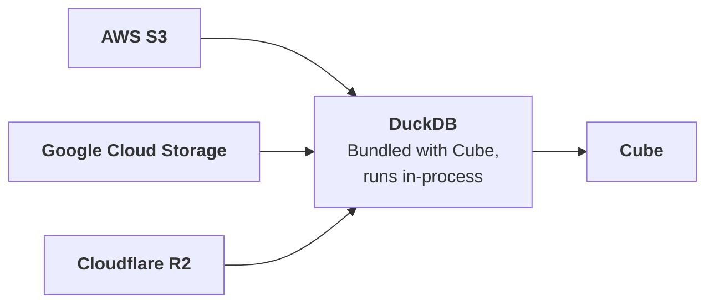
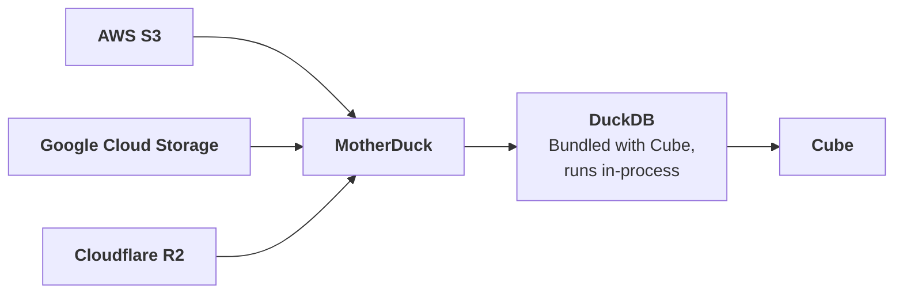

[DuckDB][duckdb] is an in-process SQL OLAP database management system, and has
support for querying data in CSV, JSON and Parquet formats from an AWS
S3-compatible blob storage. This means you can [query data stored in AWS S3,
Google Cloud Storage, or Cloudflare R2][duckdb-docs-s3-import].
You can also use the [`CUBEJS_DB_DUCKDB_DATABASE_PATH`](/reference/configuration/environment-variables#cubejs_db_duckdb_database_path) environment variable to
connect to a local DuckDB database.



Cube can also connect to [MotherDuck][motherduck], a cloud-based serverless
analytics platform built on DuckDB. When connected to MotherDuck, DuckDB uses
[hybrid execution][motherduck-docs-architecture] and routes queries to S3
through MotherDuck for better performance.



## Prerequisites

- A set of IAM credentials which allow access to the S3-compatible data source.
  Credentials are only required for private S3 buckets.
- The region of the bucket
- The name of a bucket to query data from

## Setup

### Manual

Add the following to a `.env` file in your Cube project:

```dotenv
CUBEJS_DB_TYPE=duckdb
```

### Cube Cloud

In Cube Cloud, select&nbsp;**DuckDB** when creating a new deployment
and fill in the required fields:

<Frame>
  
</Frame>

<Info>

If you are not using MotherDuck, leave the&nbsp;**MotherDuck Token**
field blank.

</Info>

<Info>

You can also explore how DuckDB works with Cube if you create a [demo
deployment][ref-demo-deployment] in Cube Cloud.

</Info>

## Environment Variables

| Environment Variable                       | Description                                                                                                           | Possible Values                                               | Required |
|--------------------------------------------|-----------------------------------------------------------------------------------------------------------------------|---------------------------------------------------------------|:--------:|
| [`CUBEJS_DB_DUCKDB_MEMORY_LIMIT`](/reference/configuration/environment-variables#cubejs_db_duckdb_memory_limit)            | The maximum memory limit for DuckDB. Equivalent to `SET memory_limit=<MEMORY_LIMIT>`. Default is 75% of available RAM | A valid memory limit                                          |    ❌     |
| [`CUBEJS_DB_DUCKDB_SCHEMA`](/reference/configuration/environment-variables#cubejs_db_duckdb_schema)                  | The [default search schema][link-duckdb-configuration-ref]                                                            | A valid schema name                                           |    ❌     |
| [`CUBEJS_DB_DUCKDB_MOTHERDUCK_TOKEN`](/reference/configuration/environment-variables#cubejs_db_duckdb_motherduck_token)        | The service token to use for connections to MotherDuck                                                                | A valid [MotherDuck service token][motherduck-docs-svc-token] |    ❌     |
| [`CUBEJS_DB_DUCKDB_DATABASE_PATH`](/reference/configuration/environment-variables#cubejs_db_duckdb_database_path)           | The database filepath to use for connection to a local database.                                                      | A valid duckdb database file path                             |    ❌     |
| `CUBEJS_DB_DUCKDB_S3_ACCESS_KEY_ID`        | The Access Key ID to use for database connections                                                                     | A valid Access Key ID                                         |    ❌     |
| `CUBEJS_DB_DUCKDB_S3_SECRET_ACCESS_KEY`    | The Secret Access Key to use for database connections                                                                 | A valid Secret Access Key                                     |    ❌     |
| `CUBEJS_DB_DUCKDB_S3_ENDPOINT`             | The S3 endpoint                                                                                                       | A valid [S3 endpoint][duckdb-docs-s3-import]                  |    ❌     |
| `CUBEJS_DB_DUCKDB_S3_REGION`               | The [region of the bucket][duckdb-docs-s3-import]                                                                     | A valid AWS region                                            |    ❌     |
| `CUBEJS_DB_DUCKDB_S3_USE_SSL`              | Use SSL for connection                                                                                                | A boolean                                                     |    ❌     |
| `CUBEJS_DB_DUCKDB_S3_URL_STYLE`            | To choose the S3 URL style(vhost or path)                                                                             | `vhost` or `path`                                             |    ❌     |
| `CUBEJS_DB_DUCKDB_S3_SESSION_TOKEN`        | The token for the S3 session                                                                                          | A valid Session Token                                         |    ❌     |
| [`CUBEJS_DB_DUCKDB_EXTENSIONS`](/reference/configuration/environment-variables#cubejs_db_duckdb_extensions)              | A comma-separated list of DuckDB extensions to install and load                                                       | A comma-separated list of DuckDB extensions                   |    ❌     |
| [`CUBEJS_DB_DUCKDB_COMMUNITY_EXTENSIONS`](/reference/configuration/environment-variables#cubejs_db_duckdb_community_extensions)    | A comma-separated list of DuckDB community extensions to install and load                                             | A comma-separated list of DuckDB community extensions         |    ❌     |
| `CUBEJS_DB_DUCKDB_S3_USE_CREDENTIAL_CHAIN` | A flag to use credentials chain for secrets for S3 connections                                                        | `true`, `false`. Defaults to `false`                          |    ❌     |
| [`CUBEJS_CONCURRENCY`](/reference/configuration/environment-variables#cubejs_concurrency)                       | The number of [concurrent queries][ref-data-source-concurrency] to the data source                                    | A valid number                                                |    ❌     |

[ref-data-source-concurrency]: /admin/connect-to-data/concurrency#data-source-concurrency
## Pre-Aggregation Feature Support

### count_distinct_approx

Measures of type
[`count_distinct_approx`][ref-schema-ref-types-formats-countdistinctapprox] can
be used in pre-aggregations when using DuckDB as a source database. To learn
more about DuckDB's support for approximate aggregate functions, [click
here][duckdb-docs-approx-agg-fns].

## Pre-Aggregation Build Strategies

<Info>

To learn more about pre-aggregation build strategies, [head
here][ref-caching-using-preaggs-build-strats].

</Info>

| Feature       | Works with read-only mode? | Is default? |
| ------------- | :------------------------: | :---------: |
| Batching      |             ❌             |     ✅      |
| Export Bucket |             -              |      -      |

By default, DuckDB uses a [batching][self-preaggs-batching] strategy to build
pre-aggregations.

### Batching

No extra configuration is required to configure batching for DuckDB.

### Export Bucket

DuckDB does not support export buckets.

## SSL

Cube does not require any additional configuration to enable SSL as DuckDB
connections are made over HTTPS.

[duckdb]: https://duckdb.org/
[duckdb-docs-approx-agg-fns]:
  https://duckdb.org/docs/sql/aggregates.html#approximate-aggregates
[duckdb-docs-s3-import]: https://duckdb.org/docs/guides/import/s3_import
[link-duckdb-configuration-ref]: https://duckdb.org/docs/sql/configuration.html#configuration-reference
[motherduck]: https://motherduck.com/
[motherduck-docs-architecture]:
  https://motherduck.com/docs/architecture-and-capabilities#hybrid-execution
[motherduck-docs-svc-token]:
  https://motherduck.com/docs/authenticating-to-motherduck/#authentication-using-a-service-token
[ref-caching-using-preaggs-build-strats]: /docs/pre-aggregations/using-pre-aggregations#pre-aggregation-build-strategies
[ref-schema-ref-types-formats-countdistinctapprox]: /reference/data-modeling/measures#type
[self-preaggs-batching]: #batching
[ref-demo-deployment]: /admin/deployment#demo-deployments