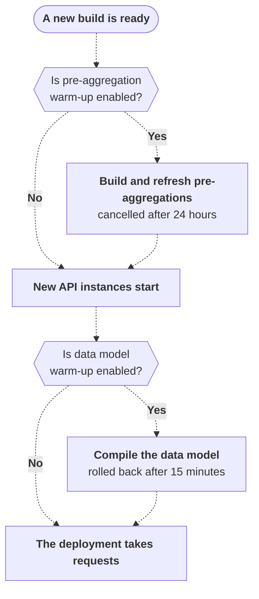

Deployment warm-up improves querying performance by executing time-consuming
tasks after a Cube Cloud deployment is spun up but before it's exposed to
requests from users.

<Note>

Available on [Starter and above plans](https://cube.dev/pricing).

</Note>

<Info>

Deployment warm-up is only available for [Dedicated][ref-prod-cluster]
and [Multi-cluster][ref-prod-multi-cluster] deployments.

</Info>

There are two warm-up options:

* [Data model warm-up](#data-model-warm-up) — compiles the data model and
populates data model compilation cache ahead of time.
* [Pre-aggregation warm-up](#pre-aggregation-warm-up) — builds and refreshes
pre-aggregations ahead of time.

Pre-aggregation warm-up runs before the new API instances start, and data model
warm-up runs as they start. Either way, a new build finishes the enabled
warm-ups before it takes requests:

## Data model warm-up

By default, an API instance compiles the [data model][ref-data-model] and
stores results in the data model compilation cache when the first request hits
that API instance. For [multi-tenant][ref-multitenancy] configurations, a
request from a particular tenant would only trigger the data model compilation
for that tenant.

Depending on the complexity of the data model (i.e., the number of cubes,
views, and their members) and the use of [dynamic data models][ref-dynamic-data-model],
its compilation might take from a few milliseconds to a few seconds.

Data-model warm-up will compile the data model before a Cube Cloud deployment
is exposed to requests from users, making sure that they aren't affected by
the data model compilation time.

<Info>
If a data model warm-up takes more than 15 minutes, the deployment will be
considered unhealthy and rolled back.

</Info>

### Configuring data model warm-up

To configure data model warm-up, navigate to **Settings → Configuration**
and enable **Warm-up data model before deploying API**:

<Frame>
  
</Frame>

## Pre-aggregation warm-up

By default, the refresh worker takes care of [pre-aggregation][ref-pre-aggs]
refresh and runs pre-aggregation builds. When first requests hit API instances,
it's possible that pre-aggregations would still be being built and users would
need to wait or the completion of that process.

Depending on the volume of data and the configuration of pre-aggregations,
their builds might take from seconds to minutes.

Pre-aggregation warm-up will refresh pre-aggregations before a Cube Cloud
deployment is exposed to requests from users, making sure they aren't affected
by the pre-aggregation build time.

<Info>

If a pre-aggregation warm-up takes more than 24 hours, it will be cancelled.
However, the deployment will still succeed.

</Info>

### Configuring pre-aggregation warm-up

To configure pre-aggregation warm-up, navigate to **Settings → Configuration**
and enable **Warm-up pre-aggregations before deploying API**:

<Frame>
  
</Frame>

[ref-prod-cluster]: /admin/deployment/deployment-types#dedicated
[ref-prod-multi-cluster]: /admin/deployment/deployment-types#multi-cluster
[ref-data-model]: /docs/data-modeling/overview
[ref-dynamic-data-model]: /docs/data-modeling/dynamic
[ref-multitenancy]: /embedding/multitenancy
[ref-pre-aggs]: /docs/pre-aggregations#pre-aggregations